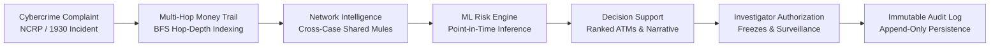

# CASHNET — AI-Assisted Cybercrime Cash-Out Risk Decision Support Platform

> **Smart India Hackathon (SIH26184)**  
> **Problem Track**: Cybercrime Financial Fraud & Mule Network Tracking  
> **Documentation Version**: 2.0  

---

## 1. Project Overview & SIH Context

**CASHNET** is an AI-assisted investigation and tactical cash-out risk decision-support platform built for **Smart India Hackathon (SIH26184)**. The platform is designed to support cybercrime investigators and law enforcement agencies (LEAs) in tracing illicit fund dispersion across multi-layered mule account networks and prioritizing physical cash withdrawal points (ATMs, branch counters, and CSP kiosks) before funds are permanently liquidated.

---

## 2. What the Prototype Does

When a victim registers a financial cybercrime complaint via the **National Cybercrime Reporting Portal (NCRP / 1930 incident response)**, illicit funds are rapidly routed through layers of digital wallets and intermediary mule accounts before being physically withdrawn at automated teller machines (ATMs), bank branch counters, or Customer Service Point (CSP) kiosks.

CASHNET provides an integrated platform that:
1. **Reconstructs Money Trails**: Automatically traverses multi-hop transaction networks using Breadth-First Search (BFS) graph analysis to map fund dispersal paths from the victim account down through intermediary mule layers.
2. **Detects Infrastructure Cycles & Anomalies**: Identifies topological patterns including circular fund movements, account branching, isolated islands, and duplicate transactions.
3. **Discovers Cross-Case Syndicates**: Uncovers shared mule accounts and co-occurring infrastructure connecting multiple independent complaints.
4. **Predicts Cash-Out Risk & Priority Locations**: Evaluates point-in-time machine learning features (Model A occurrence classifier) and spatial candidate proximity (Model B distance ranking) to estimate withdrawal likelihood and rank candidate terminals for tactical monitoring.
5. **Provides Explainable Decision Support**: Generates structured narrative explanations, risk/protective factors, and recommended investigator actions without taking autonomous enforcement actions.
6. **Maintains Append-Only Audit Logging**: Logs all investigator actions and prediction executions in immutable database audit records.

---

## 3. Problem & Proposed Investigation Workflow

### The Challenge
In financial cybercrime, the window between incident occurrence and cash-out is often short (frequently under 2 hours). Manual inspection of bank statements across multiple payment rails (UPI, IMPS, NEFT, RTGS) delays identification of the final mule accounts and physical cash-out locations.

### The CASHNET Workflow



1. **Intake & Ingestion**: Incident complaint, victim details, and transaction ledgers are imported and indexed.
2. **Money Trail Traversal**: Graph traversal identifies all participating accounts, hop levels (Hop 0 = victim, Hop 1 = first layer mule, etc.), and cumulative outflows.
3. **Syndicate Correlation**: The network intelligence engine checks for account co-occurrence across existing active and archived cases.
4. **Point-in-Time Prediction**: Feature vectors computed strictly up to the complaint registration timestamp are evaluated by the occurrence model and spatial ranker.
5. **Human-in-the-Loop Review**: Investigators review the visual graph, candidate terminals, and risk factors in the web dashboard.
6. **Action & Audit Logging**: Investigator-authorized decisions (e.g., account debit freezes, CCTV retrieval requests) are recorded immutably.

---

## 4. Main Features

- **Multi-Hop Money Trail Reconstruction**: Deterministic BFS indexing mapping fund dispersal up to arbitrary hop depths with cycle detection (3-color DFS state machine) and branching metrics.
- **Cross-Case Syndicate Intelligence**: Relational mapping of shared mule accounts across multiple complaints with co-occurrence metrics and syndicate clustering.
- **Point-in-Time ML Prediction Engine**:
  - **Model A (Occurrence Classifier)**: Random Forest classifier operating on 26 point-in-time features to estimate cash-out occurrence probability.
  - **Model B (Spatial Proximity Ranker)**: Haversine distance-based candidate ranking prioritizing nearby ATMs and branch kiosks.
  - **Model C (Timing Baseline)**: Experimental timing regressor estimating minutes to cashout (presented with explicit high-uncertainty warnings).
- **Interactive Web Dashboard**: React 18 + Vite SPA featuring interactive SVG network graphs, case dossiers, GIS location mapping, and on-demand risk assessments.
- **RESTful API**: 17 versioned endpoints (`/api/v1`) with OpenAPI / Swagger interactive documentation.
- **Strict Anti-Leakage Protocol**: Architectural isolation of evaluation ground truth from operational inference and investigative dossiers.
- **Append-Only Audit Trails**: SQLAlchemy event-listener-protected tables for investigator actions and prediction provenance.

---

## 5. System Architecture & Technology Stack

### Architecture Overview

```
┌────────────────────────────────────────────────────────┐
│             React 18 + Vite SPA Frontend               │
│      (TypeScript, Tailwind CSS, Lucide, Vitest)        │
└───────────────────────────┬────────────────────────────┘
                            │ REST API (/api/v1, /health)
┌───────────────────────────▼────────────────────────────┐
│                  FastAPI Backend                       │
│    (Python 3.11+, Pydantic v2, Serverless ASGI)        │
├────────────────────────────────────────────────────────┤
│ Services: Case, MoneyTrail, Network, Prediction, GIS   │
├────────────────────────────────────────────────────────┤
│ ML Engine: scikit-learn (Joblib Artifacts, 26 Feats)   │
└───────────────────────────┬────────────────────────────┘
                            │ SQLAlchemy 2.0 ORM
┌───────────────────────────▼────────────────────────────┐
│               Database Layer (Relational)              │
│   SQLite (Local Dev) / Managed PostgreSQL (Production) │
│       Alembic Migrations · Connection Pooling          │
└────────────────────────────────────────────────────────┘
```

### Technology Stack

| Layer | Technology | Purpose |
|---|---|---|
| **Frontend** | React 18, TypeScript, Vite, Tailwind CSS | Single Page Application dashboard |
| **Backend API** | FastAPI 0.110+, Python 3.11+ | High-performance ASGI REST API |
| **Data Validation** | Pydantic v2, Pydantic Settings | Strict schema enforcement and type validation |
| **ORM & Migrations** | SQLAlchemy 2.0, Alembic | Relational mapping and schema evolution |
| **Database** | SQLite (Dev) / PostgreSQL (Prod) | Structured persistence with connection pooling |
| **Machine Learning** | scikit-learn 1.3+, NumPy, pandas, joblib | Lightweight offline-trained inference artifacts |
| **Testing** | pytest 7.4+, httpx, vitest 1.6+ | Automated backend and frontend test suites |
| **Deployment** | Vercel (Serverless Python + Edge CDN) | Serverless cloud hosting without container overhead |

---

## 6. Repository Structure

```
Dataset/
├── .env.example                    # Environment variable template
├── .gitignore                      # Git exclusion rules (DBs, caches, node_modules)
├── AGENTS.md                       # Operating instructions for AI coding agents
├── README.md                       # Master project overview (this file)
├── package.json                    # Workspace scripts for frontend build/test
├── requirements.txt                # Python runtime dependencies
├── alembic.ini                     # Alembic migration configuration
├── vercel.json                     # Vercel serverless build and routing configuration
│
├── api/
│   └── index.py                    # Vercel Serverless Function entry point (FastAPI ASGI)
│
├── docs/                           # Technical Documentation Suite
│   ├── ARCHITECTURE.md             # In-depth system architecture & security flows
│   ├── API_REFERENCE.md            # REST API endpoint specifications & schemas
│   ├── CASHNET_PROJECT_CONTEXT.md  # Detailed project problem and design context
│   ├── DATABASE_SCHEMA.md          # 13 ORM models, relations, and ER diagram
│   ├── DATA_AND_ML_CONSTRAINTS.md  # Feature definitions, point-in-time & anti-leakage rules
│   ├── DEMONSTRATION_GUIDE.md      # Step-by-step evaluator walkthrough
│   ├── DESIGN_SYSTEM.md            # UI design tokens and visual hierarchy
│   ├── DEVELOPMENT_GUIDE.md        # Local development setup & CLI guide
│   ├── DEVELOPMENT_ROADMAP.md      # Milestones, stages, and acceptance criteria
│   ├── IMPLEMENTATION_STATUS.md    # Stage-by-stage implementation and test record
│   └── VERCEL_DEPLOYMENT_GUIDE.md  # Production cloud deployment guide
│
├── src/
│   ├── backend/                    # FastAPI Backend Application
│   │   ├── main.py                 # Application factory and lifespan manager
│   │   ├── config.py               # Pydantic Settings & environment parsing
│   │   ├── api/                    # Route handlers (health, cases, accounts, locations, predictions)
│   │   ├── db/                     # SQLAlchemy base, models, and session management
│   │   ├── schemas/                # Pydantic request/response schemas
│   │   ├── services/               # Business services (Case, MoneyTrail, Network, Prediction, GIS)
│   │   └── importer/               # CSV batch data ingestion pipeline
│   │
│   ├── frontend/                   # React 18 + Vite SPA Frontend
│   │   ├── src/
│   │   │   ├── api/                # Typed API client and mock fallback
│   │   │   ├── components/         # Reusable UI components (Graph, Dossier, Predictor, GIS)
│   │   │   ├── types/              # TypeScript interface definitions
│   │   │   ├── App.tsx             # Main dashboard layout and navigation
│   │   │   └── main.tsx            # React application root
│   │   ├── package.json            # Frontend dependencies
│   │   ├── vite.config.ts          # Vite configuration
│   │   └── tailwind.config.js      # Tailwind CSS configuration
│   │
│   └── synthetic_data/             # Synthetic Data Generation Package
│       ├── generate.py             # Data generation orchestrator
│       ├── validate.py             # Temporal and relational validator
│       └── export.py               # CSV export utility
│
├── alembic/
│   ├── env.py                      # Alembic environment configuration
│   └── versions/                   # Versioned database migration scripts
│
├── models/                         # ML Model Artifacts & Manifests
│   ├── occurrence_baseline.joblib  # Model A: Occurrence Classifier (Active)
│   ├── timing_baseline.joblib      # Model C: Timing Regressor (Experimental)
│   ├── location_baseline.joblib    # Model B: Candidate Ranker (Rejected artifact reference)
│   ├── feature_manifest_used.json  # Exact 26-feature sequence manifest
│   └── evaluation_config.json      # Dataset split and seed parameters
│
├── data_v2/                        # Synthetic Prototype Dataset
│   ├── raw/                        # 7 relational CSV tables (complaints, accounts, transactions, locations, etc.)
│   ├── processed/                  # 3 feature tables (snapshots, candidates, case_features)
│   └── evaluation/                 # 1 isolated ground truth table (prediction_ground_truth.csv)
│
├── tests/                          # Automated Pytest Suite (82 backend tests)
│   ├── test_backend_api.py         # REST API endpoints, filtering, pagination
│   ├── test_money_trail.py         # Multi-hop BFS, branching, cycle detection
│   ├── test_network_intelligence.py# Cross-case syndicates, shared accounts
│   ├── test_prediction_service.py  # Model inference, feature assembly, provenance
│   ├── test_data_leakage.py        # Anti-leakage isolation invariants
│   └── ...                         # Data generation, reproducibility, scenarios
│
├── scripts/                        # Operational CLI Utilities
│   ├── import_data.py              # Data ingestion CLI
│   ├── train_baselines.py          # ML baseline training pipeline
│   ├── verify_models.py            # Independent model verification
│   └── audit_dataset.py            # Dataset audit script
│
└── database/                       # SQL Schema Definitions
    ├── schema.sql                  # PostgreSQL-compatible schema
    ├── indexes.sql                 # Index definitions
    └── seed.sql                    # Seed data
```

---

## 7. Prerequisites

Before running CASHNET locally, ensure the following software is installed:
- **Python**: `3.11+`
- **Node.js**: `18.0+` (with `npm 9+`)
- **Git**: `2.30+`

---

## 8. Local Setup Instructions

### 1. Clone the Repository
```bash
git clone https://github.com/YourOrg/CASHNET.git
cd CASHNET
```

### 2. Backend Setup
```bash
# Create and activate a Python virtual environment
python3 -m venv .venv
source .venv/bin/activate  # On Windows: .venv\Scripts\activate

# Install backend dependencies
pip install -r requirements.txt
```

### 3. Frontend Setup
```bash
# Navigate to frontend directory and install dependencies
cd src/frontend
npm install
cd ../..
```

---

## 9. Database Setup & Migrations

CASHNET defaults to a local SQLite database (`cashnet_dev.db`) for development, with zero configuration required.

```bash
# Run database migrations to initialize tables
python3 -m alembic upgrade head
```

To use a managed PostgreSQL database, set `DATABASE_URL` in your environment or `.env` file before running the migration command.

---

## 10. Synthetic Data Ingestion

Populate the database with the synthetic prototype dataset (5,000 cases, 10,001 accounts, 65,000+ transactions, 300 locations):

```bash
# Perform a clean wipe and full dataset import
python3 scripts/import_data.py --wipe

# Validate dataset integrity (optional)
python3 scripts/import_data.py --validate-only
```

---

## 11. Environment Configuration

Copy `.env.example` to `.env` to customize settings:

```bash
cp .env.example .env
```

Key environment variables:

| Variable | Default | Description |
|---|---|---|
| `DATABASE_URL` | `sqlite:///./cashnet_dev.db` | Database connection string (SQLite or PostgreSQL) |
| `DB_ECHO` | `false` | Enable SQLAlchemy SQL query logging |
| `DB_POOL_SIZE` | `10` | Database connection pool size (for PostgreSQL) |
| `DB_MAX_OVERFLOW` | `20` | Database connection pool max overflow |
| `CORS_ORIGINS` | `["*"]` | Allowed CORS origins (JSON array or comma-separated) |
| `MODELS_DIR` | `models` | Directory containing serialized ML joblib artifacts |
| `DEFAULT_DATA_DIR` | `data_v2` | Synthetic dataset directory |
| `SIMULATION_MODE` | `true` | Declares all records and predictions are synthetic |
| `DEBUG` | `false` | Enable verbose debugging and stack traces |
| `VITE_API_BASE_URL` | *(empty)* | Custom API URL for frontend (leave empty for same-origin) |

---

## 12. Running the Application Locally

### Start Backend API Server
```bash
python3 -m uvicorn src.backend.main:app --host 0.0.0.0 --port 8000 --reload
```
- **API Documentation (Swagger UI)**: [http://localhost:8000/docs](http://localhost:8000/docs)
- **API Documentation (ReDoc)**: [http://localhost:8000/redoc](http://localhost:8000/redoc)
- **Health Check**: [http://localhost:8000/health](http://localhost:8000/health)

### Start Frontend Development Server
In a separate terminal:
```bash
cd src/frontend
npm run dev
```
- **Investigator Dashboard UI**: [http://localhost:5173](http://localhost:5173)

---

## 13. Running Automated Tests

CASHNET includes complete test suites for both backend and frontend.

### Backend Test Suite (Pytest — 82 Tests)
```bash
# Run the full backend test suite
pytest -v

# Run specific domain test suites
pytest tests/test_backend_api.py -v          # REST API endpoints & pagination
pytest tests/test_money_trail.py -v          # Money trail BFS & cycle detection
pytest tests/test_network_intelligence.py -v # Cross-case shared accounts
pytest tests/test_prediction_service.py -v   # ML prediction orchestration & audit
pytest tests/test_data_leakage.py -v         # Anti-leakage isolation invariants
```

### Frontend Test Suite (Vitest — 20 Tests)
```bash
# Run frontend tests from root workspace
npm test

# Or run directly in src/frontend
cd src/frontend
npm test -- --run
```

### Frontend Production Build Verification
```bash
npm run build
```

---

## 14. Vercel Cloud Deployment

CASHNET is configured for deployment on **Vercel** as a unified full-stack application without Docker, Kubernetes, or manual server maintenance.

### Architecture on Vercel:
- **Frontend**: Compiled into `src/frontend/dist` and served via Vercel's global CDN.
- **Backend API**: Python Serverless Function (`api/index.py`) serving the FastAPI ASGI application.
- **Database**: External managed PostgreSQL (e.g., Neon, Supabase, Vercel Postgres, AWS RDS).
- **ML Artifacts**: Pre-trained scikit-learn models (2.8MB total) bundled directly in the serverless function.

### Deployment Steps:
1. Push the repository to GitHub.
2. In the Vercel Dashboard, import the GitHub repository.
3. Configure Project Settings:
   - **Framework Preset**: `Vite` (or `Other`)
   - **Build Command**: `npm run build`
   - **Output Directory**: `src/frontend/dist`
   - **Install Command**: `npm install`
4. Configure Environment Variables in Vercel:
   - `DATABASE_URL`: `postgresql://<user>:<password>@<host>/<database>?sslmode=require`
   - `SIMULATION_MODE`: `true`
5. Apply migrations and import synthetic data to your hosted database:
   ```bash
   export DATABASE_URL="postgresql://<user>:<password>@<host>/<database>?sslmode=require"
   python3 -m alembic upgrade head
   python3 scripts/import_data.py --wipe
   ```
6. Click **Deploy**.

*For complete details, see [docs/VERCEL_DEPLOYMENT_GUIDE.md](docs/VERCEL_DEPLOYMENT_GUIDE.md).*

---

## 15. Known Limitations & Prototype Safeguards

### System Constraints
1. **Advisory Decision Support Only**: CASHNET produces risk assessments and prioritized candidate lists for human investigator review. The prototype does **not** execute automated account freezes, dispatch field officers, or issue legal declarations.
2. **Model B Fallback Policy**: The spatial ranker in `models/location_baseline.joblib` was rejected due to an identified synthetic candidate injection artifact ($P(\text{Target} \mid \text{dist} > 50\text{km}) = 88.74\%$). The platform employs a verified distance-based proximity heuristic (71.73% Top-1 accuracy) in operational paths.
3. **Model C Timing Baseline Uncertainty**: Model C is an experimental baseline with high variance ($MAE \approx 41.8\text{ min}, R^2 \approx 0.00$) due to the uniform random delay distribution $\text{Uniform}(10, 180\text{ min})$ used in the synthetic generator. Outputs are flagged with a high-uncertainty notice.
4. **Point-in-Time Availability**: Features and dossiers reflect data available up to the snapshot timestamp. Out-of-band updates after the complaint timestamp are not incorporated into past inference vectors.

### Strict Anti-Leakage Protocol
- The `prediction_ground_truth` table is strictly segregated for offline benchmark evaluation and is **never** accessed by operational API endpoints or case dossiers.
- Events where `is_future_ground_truth = True` are filtered out from all case transaction ledgers and money trail graphs.

---

## 16. Synthetic Data & Ethical Declaration

> **SYNTHETIC PROTOTYPE NOTICE:**  
> All case records, account numbers, victim names, transaction amounts, timestamps, and geographic coordinates in this repository are **purely synthetic prototype data** generated for algorithm development, evaluation, and system benchmarking under Smart India Hackathon (SIH26184).  
>
> - The software does **not** connect to, access, or store data from live banking cores, real KYC repositories, Aadhaar records, or live LEA databases.
> - The synthetic labels reflect simulated test scenarios and do not represent actual real-world individuals, bank accounts, or criminal activity.
> - Synthetic evaluation metrics demonstrate algorithmic functionality under simulated conditions and do not establish real-world operational efficacy.

---

## 17. Documentation Directory

For in-depth technical documentation, refer to the `docs/` directory:

| Document | Description |
|---|---|
| [**docs/ARCHITECTURE.md**](docs/ARCHITECTURE.md) | In-depth system architecture, module responsibilities, sequence diagrams, and security |
| [**docs/API_REFERENCE.md**](docs/API_REFERENCE.md) | Comprehensive REST API contract, request/response schemas, and example payloads |
| [**docs/DATABASE_SCHEMA.md**](docs/DATABASE_SCHEMA.md) | Database entities, relational constraints, indices, and Mermaid ER diagram |
| [**docs/DATA_AND_ML_CONSTRAINTS.md**](docs/DATA_AND_ML_CONSTRAINTS.md) | Feature manifest definitions, anti-leakage invariants, and model performance bounds |
| [**docs/DEVELOPMENT_GUIDE.md**](docs/DEVELOPMENT_GUIDE.md) | Local development setup, migration commands, dataset import, and testing guide |
| [**docs/DEMONSTRATION_GUIDE.md**](docs/DEMONSTRATION_GUIDE.md) | Evaluator demonstration script and walkthrough for hackathon judging |
| [**docs/DESIGN_SYSTEM.md**](docs/DESIGN_SYSTEM.md) | Design principles, color tokens, and UI layout hierarchy |
| [**docs/IMPLEMENTATION_STATUS.md**](docs/IMPLEMENTATION_STATUS.md) | Implementation milestones, component verification, and test coverage |
| [**docs/VERCEL_DEPLOYMENT_GUIDE.md**](docs/VERCEL_DEPLOYMENT_GUIDE.md) | Step-by-step production cloud deployment runbook for Vercel + PostgreSQL |

---

## 18. License & Attribution

Developed for **Smart India Hackathon (SIH26184)**.

When contributing code changes:
```
Co-Authored-By: Claude Code <noreply@anthropic.com>
```
