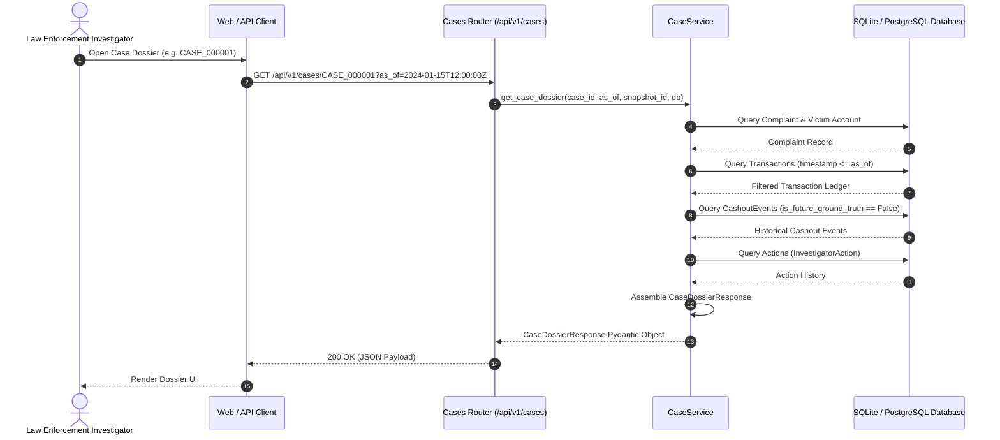
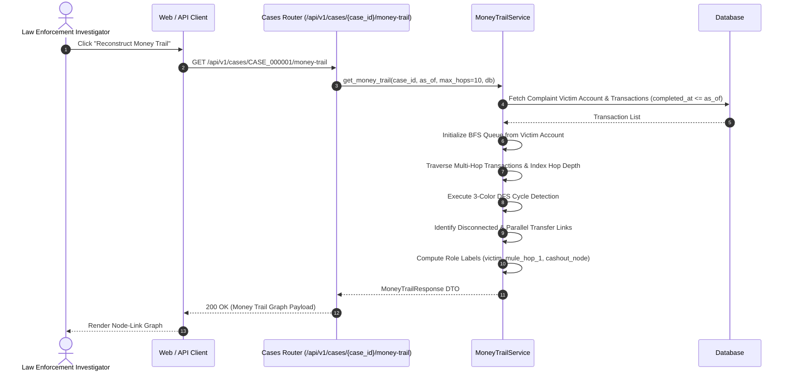
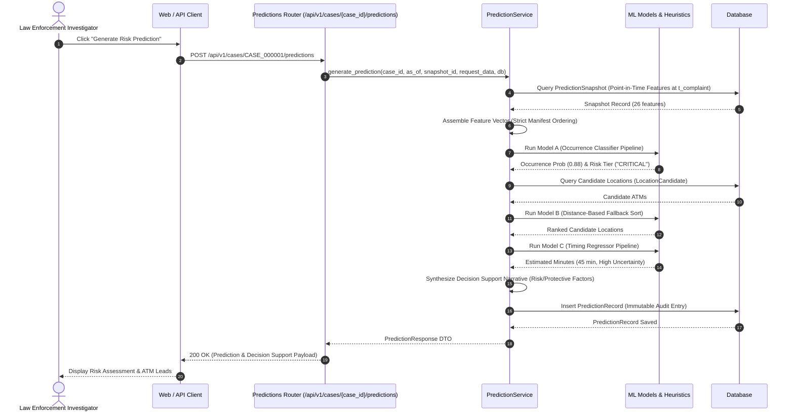
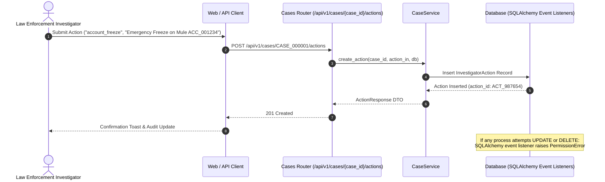

# CASHNET System Architecture & Design Specification

> **Smart India Hackathon (SIH26184)**  
> **AI-Powered Cybercrime Cash-Out Prediction & Investigator Decision-Support Platform**  
> **Documentation Version**: 2.0  
> **Last Verified**: 2026-09-28

---

## 1. Master System Architecture Overview

CASHNET is built as a multi-tier, modular decision-support system designed for high reliability, temporal integrity, and forensic transparency.

```
┌─────────────────────────────────────────────────────────────────────────────────┐
│                           INVESTIGATOR CLIENTS & UI                             │
│       Investigator Dashboard (Stage 4)  │  GIS Map View (Stage 5)  │  CLI/API   │
└────────────────────────────────────────┬────────────────────────────────────────┘
                                         │ HTTPS / REST (JSON)
                                         ▼
┌─────────────────────────────────────────────────────────────────────────────────┐
│                          FASTAPI APPLICATION LAYER                              │
│  Lifespan Context Manager │ CORS Middleware │ Pydantic Request/Response Models │
│  API Router Aggregator (/api/v1)                                                │
│  ├── /health (System Diagnostics & Live DB Table Counts)                        │
│  ├── /cases (Dossiers, Transactions, Accounts, Graph, Network, Actions)        │
│  ├── /accounts (Cross-Case Network Profiles, Multi-Trail Participation)        │
│  ├── /locations (GIS Radius Queries & Spatial Coordinates)                     │
│  └── /predictions (Point-in-Time ML Inference & Audit History)                 │
└────────────────────────────────────────┬────────────────────────────────────────┘
                                         │ Dependency Injection: Depends(get_db)
                                         ▼
┌─────────────────────────────────────────────────────────────────────────────────┐
│                           BUSINESS SERVICE LAYER                                │
│  ┌───────────────────────┐  ┌─────────────────────────┐  ┌──────────────────┐  │
│  │     CaseService       │  │    MoneyTrailService    │  │  NetworkService  │  │
│  │ Case Dossiers, Search │  │ Multi-Hop BFS, Topology │  │ Syndicates, Hubs │  │
│  └───────────────────────┘  └─────────────────────────┘  └──────────────────┘  │
│  ┌───────────────────────┐  ┌─────────────────────────┐  ┌──────────────────┐  │
│  │    LocationService    │  │    PredictionService    │  │  HealthService   │  │
│  │ Spatial Radius Search │  │ 26-Feature Assembly     │  │ Diagnostic Check │  │
│  └───────────────────────┘  └────────────┬────────────┘  └──────────────────┘  │
└──────────────────────────────────────────┼──────────────────────────────────────┘
                                           │ Loads Serialized Artifacts (.joblib)
                                           ▼
┌─────────────────────────────────────────────────────────────────────────────────┐
│                        MACHINE LEARNING SUBSYSTEM                               │
│  ┌─────────────────────────┐ ┌─────────────────────────┐ ┌───────────────────┐  │
│  │   Model A: Classifier   │ │ Model B: Location Rank  │ │ Model C: Timing   │  │
│  │ 26 Features → RF Binary │ │ Proximity Fallback      │ │ RF Regressor      │  │
│  │ Future Cash-Out Prob.   │ │ Distance-Sorted ATMs    │ │ High Uncertainty  │  │
│  └─────────────────────────┘ └─────────────────────────┘ └───────────────────┘  │
│  ┌───────────────────────────────────────────────────────────────────────────┐  │
│  │ Structured Narrative Explanation Engine (Risk/Protective Factors)         │  │
│  └───────────────────────────────────────────────────────────────────────────┘  │
└──────────────────────────────────────────┬──────────────────────────────────────┘
                                           │ SQLAlchemy 2.0 ORM Sessions
                                           ▼
┌─────────────────────────────────────────────────────────────────────────────────┐
│                      DATA ACCESS & PERSISTENCE LAYER                            │
│  SQLAlchemy 2.0 Declarative Models │ Alembic Schema Migrations                  │
│  Append-Only Event Listeners (before_update, before_delete)                     │
│                                                                                 │
│  [OPERATIONAL EVIDENCE]          [GRAPH & FEATURES]       [AUDIT TRAILS]        │
│  - complaints                   - prediction_snapshots   - investigator_actions │
│  - accounts                     - location_candidates    - prediction_records   │
│  - transactions                 - case_features                                 │
│  - cashout_events               - case_relationships                            │
│  - locations                                                                    │
│  - account_labels                                                               │
│                                                                                 │
│  ============================= AIR-GAP BOUNDARY ==============================  │
│  [ISOLATED EVALUATION GROUND TRUTH] (Strictly Forbidden in Operational Code)    │
│  - prediction_ground_truth                                                      │
└─────────────────────────────────────────────────────────────────────────────────┘
```

---

## 2. Layer-by-Layer Architectural Breakdown

### 2.1 FastAPI Routing Layer (`src/backend/api/`)

The API layer is organized under a versioned router structure (`/api/v1`):

- **`main.py`**:
  - Configures FastAPI application lifecycle via `asynccontextmanager` (`lifespan`).
  - Implements CORS middleware, global exception handlers, and database connection warmup.
  - Mounts root diagnostic endpoints (`/health`) and the aggregated API router.
- **`router.py`**:
  - Central aggregator including individual route modules: `health`, `cases`, `accounts`, `locations`, `predictions`.
- **`routes/cases.py`**:
  - Implements 10 case-centric endpoints: filtering, dossier retrieval, transaction ledgers, account roles, money trail analysis, visual graph payloads, cross-case network intelligence, related cases, and investigator actions.
- **`routes/accounts.py`**:
  - Implements account network analysis and cross-case money trail participation endpoints.
- **`routes/locations.py`**:
  - Exposes ATM/branch listings with Haversine spatial radius filtering.
- **`routes/predictions.py`**:
  - Handles prediction execution triggers, prediction history listings, and immutable prediction audit record retrieval.
- **`routes/health.py`**:
  - Performs live connectivity checks and returns real-time table counts.

### 2.2 Business Service Layer (`src/backend/services/`)

The service layer contains all domain business logic, graph algorithms, and orchestration:

- **`CaseService`**:
  - Retrieves filterable and paginated case listings.
  - Resolves temporal query boundaries (`as_of` timestamp or `snapshot_id`).
  - Hydrates complete case dossiers including victim account details and transaction history.
  - Enforces that future ground truth cashout events are never returned in case transaction listings.
  - Persists new investigator actions in the append-only audit table.
- **`MoneyTrailService`**:
  - Reconstructs multi-hop transaction flows originating from the victim account using Breadth-First Search (BFS).
  - Assigns deterministic hop-depth indices ($0$ for victim, $1$ for primary layer, $2$ for secondary layer, etc.).
  - Performs directed cycle detection using a 3-color state Depth-First Search (DFS) algorithm (`WHITE` = unvisited, `GRAY` = currently exploring, `BLACK` = fully explored).
  - Identifies disconnected links, branching factors, and calculates graph density metrics.
  - Formats node-link payloads optimized for frontend visualization libraries.
- **`NetworkService`**:
  - Discovers inter-case co-occurrence links where accounts appear in multiple complaint trails.
  - Groups co-occurring cases into syndicate clusters and computes total shared financial volumes.
  - Profiles individual accounts across historical complaints, summarizing total inflows, outflows, and connected entities.
- **`LocationService`**:
  - Manages ATM, branch, and CSP kiosk terminal coordinates.
  - Implements Haversine great-circle distance filtering for spatial radius queries.
- **`PredictionService`**:
  - Assembles point-in-time 26-feature vectors from `PredictionSnapshot` or dynamically from case metadata.
  - Loads and caches ML model artifacts from `models/`.
  - Executes Model A (Occurrence Classifier) with risk tiering.
  - Executes Model B (Candidate Location Prioritizer) using the distance-based fallback policy.
  - Executes Model C (Timing Regressor) with high-uncertainty disclosures.
  - Synthesizes explainable narrative summaries with specific risk and protective factors.
  - Persists immutable prediction runs into `PredictionRecord`.
- **`HealthService`**:
  - Executes diagnostic checks across database connectivity, table record counts, and ML artifact availability.

### 2.3 Data Access Layer (`src/backend/db/`)

- **`base.py`**:
  - Defines the SQLAlchemy 2.0 `DeclarativeBase` (`Base`).
  - Implements standardized constraint naming conventions (`fk_%(table_name)s_%(column_0_name)s_%(referred_table_name)s`, `pk_%(table_name)s`, `ix_%(table_name)s_%(column_0_name)s`, `uq_%(table_name)s_%(column_0_name)s`, `ck_%(table_name)s_%(constraint_name)s`).
- **`session.py`**:
  - Configures SQLAlchemy `Engine` and `sessionmaker` (`SessionLocal`).
  - Provides FastAPI dependency `get_db()` yielding per-request database sessions with automatic cleanup.
- **`models.py`**:
  - Defines 13 relational entities with explicit relationships, cascading rules, and composite indexes.
  - Implements SQLAlchemy event listeners (`before_update`, `before_delete`) on `InvestigatorAction` to enforce append-only immutability.
- **`alembic/`**:
  - Manages schema migrations and version history.

### 2.4 Machine Learning Subsystem (`models/` & `src/backend/services/prediction_service.py`)

- **Model A (Occurrence Classifier)**:
  - Artifact: `models/occurrence_baseline.joblib`
  - Pipeline: `SimpleImputer(strategy="median")` + `RandomForestClassifier(n_estimators=100, random_state=42)`
  - Input: 26 features in exact order specified in `models/feature_manifest_used.json`
  - Output: Binary probability $P(\text{has\_future\_cashout} = 1)$ mapped to 4 risk tiers:
    - Low: $[0.00, 0.30)$
    - Moderate: $[0.30, 0.60)$
    - High: $[0.60, 0.85)$
    - Critical: $[0.85, 1.00]$
- **Model B (Candidate Location Prioritizer)**:
  - Strategy: Distance-based proximity baseline heuristic.
  - Sort order: `distance_from_account_km ASC`, `historical_cashout_count DESC`.
  - Rejection Note: The learned Random Forest ranker in `models/location_baseline.joblib` is rejected due to synthetic candidate injection artifacts and must not be used.
- **Model C (Timing Regressor)**:
  - Artifact: `models/timing_baseline.joblib`
  - Pipeline: `SimpleImputer(strategy="median")` + `RandomForestRegressor(n_estimators=100, random_state=42)`
  - Output: Estimated minutes until physical cash withdrawal with high-uncertainty caveat.
- **Explanation Engine**:
  - Evaluates feature thresholds (e.g., rapid transfer velocity, high branching, mule accounts) to generate dynamic risk factors, protective factors, and tactical recommendations.

---

## 3. End-to-End Sequence Flows

### 3.1 Case Dossier Retrieval Sequence



---

### 3.2 Money Trail Reconstruction Sequence



---

### 3.3 Point-in-Time Prediction Execution Sequence



---

### 3.4 Investigator Action Logging Sequence



---

## 4. Data Boundaries and Anti-Leakage Architecture

To maintain absolute legal and scientific validity, CASHNET enforces three strict data isolation boundaries:

```
┌─────────────────────────────────────────────────────────────────────────┐
│                       OPERATIONAL BOUNDARY                              │
│                                                                         │
│  All data accessed by API routes and services must satisfy:             │
│                                                                         │
│  1. TEMPORAL RULE:                                                      │
│     transaction.completed_at <= as_of_timestamp                        │
│                                                                         │
│  2. CASHOUT VISIBILITY RULE:                                            │
│     cashout_event.is_future_ground_truth == False                       │
│                                                                         │
│  3. GROUND TRUTH EXCLUSION RULE:                                        │
│     NO queries to prediction_ground_truth table                         │
│                                                                         │
├─────────────────────────────────────────────────────────────────────────┤
│                     =======================                             │
│                     AIR-GAP ISOLATION WALL                              │
│                     =======================                             │
├─────────────────────────────────────────────────────────────────────────┤
│                       EVALUATION BOUNDARY                               │
│                                                                         │
│  prediction_ground_truth table contains:                                │
│  - has_future_cashout (Boolean ground truth label)                      │
│  - actual_next_location_id (True terminal ID)                           │
│  - actual_next_cashout_at (Exact future timestamp)                      │
│  - actual_minutes_until_cashout (Exact elapsed minutes)                 │
│  - actual_cashout_amount (Exact withdrawn amount)                       │
│  - evaluation_status ("train" | "test" | "validation")                  │
│                                                                         │
│  ACCESSIBLE ONLY TO: scripts/train_baselines.py & verify_models.py      │
└─────────────────────────────────────────────────────────────────────────┘
```

### 4.1 Temporal Boundaries (`as_of` and `snapshot_id`)
- Every investigative query accepts an optional `as_of` ISO-8601 timestamp.
- If omitted, the default point-in-time cutoff is the complaint's `complaint_registered_at` timestamp.
- All transaction queries filter strictly: `Transaction.completed_at <= as_of`.
- Graph reconstructions exclude transactions executed after the `as_of` boundary.

### 4.2 Append-Only Audit Integrity
- `InvestigatorAction` records are protected by database-level hooks:
```python
@event.listens_for(InvestigatorAction, "before_update")
def receive_investigator_action_before_update(mapper, connection, target):
    raise PermissionError("InvestigatorAction records are append-only and cannot be modified.")

@event.listens_for(InvestigatorAction, "before_delete")
def receive_investigator_action_before_delete(mapper, connection, target):
    raise PermissionError("InvestigatorAction records are append-only and cannot be deleted.")
```

---

## 5. Error Handling, Validation, and Design Patterns

1. **Dependency Injection**: Database sessions (`get_db`) and settings are injected into route handlers using FastAPI's `Depends` system, ensuring loose coupling and easy mocking during tests.
2. **Schema Validation**: All input bodies and query parameters are strictly validated using Pydantic v2 schemas. Missing fields, invalid date formats, or out-of-range numerical values trigger `422 Unprocessable Entity` responses.
3. **Explicit 404 & 400 Exceptions**: Non-existent cases, accounts, locations, or predictions raise standardized `HTTPException(status_code=404, detail="...")` errors.
4. **Model Fallback Patterns**: If ML artifacts are missing or fail to load, the service degrades gracefully with informative warning diagnostics rather than crashing the API process.
5. **Hermetic Test Fixtures**: Automated tests use an in-memory SQLite database (`sqlite:///:memory:`) configured with isolated table creations per test session.

---

**Last Updated**: 2026-09-28  
**Documentation Version**: 2.0  
**Status**: Stage 3 Architecture Verified Complete
