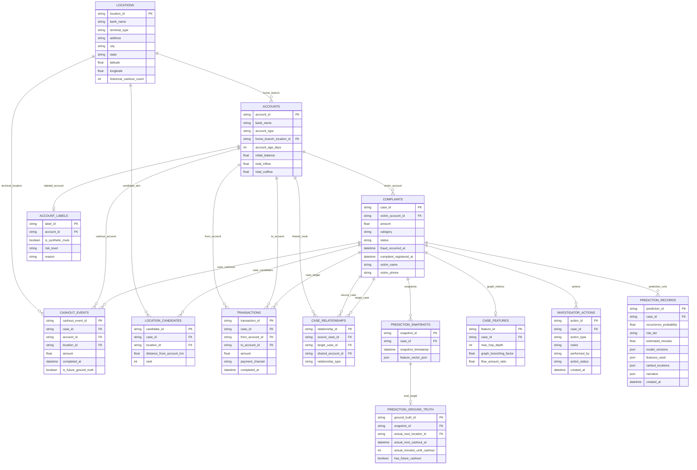

# CASHNET Relational Database Schema & Data Dictionary

> **Smart India Hackathon (SIH26184)**  
> **AI-Powered Cybercrime Cash-Out Prediction & Investigator Decision-Support Platform**  
> **Documentation Version**: 2.0  
> **ORM Engine**: SQLAlchemy 2.0 (PostgreSQL / SQLite Compatible)  
> **Migration Manager**: Alembic

---

## 1. Schema Overview & Design Principles

The CASHNET database architecture is engineered around four core tenets:
1. **Relational Integrity**: Strict foreign key constraints with composite indexes for sub-millisecond graph and ledger traversal.
2. **Temporal Point-in-Time Support**: Explicit timestamp indexing (`completed_at`, `fraud_occurred_at`, `complaint_registered_at`) across all transactional entities.
3. **Forensic Immutability**: Critical audit logs (`investigator_actions`, `prediction_records`) are append-only. Event listeners enforce that modifications and deletions raise `PermissionError` at the database session level.
4. **Strict Ground-Truth Isolation**: The `prediction_ground_truth` table is structurally separated and forbidden from operational joins.

---

## 2. Mermaid Entity-Relationship (ER) Diagram

---

## 3. Entity Data Dictionary (13 Relational Tables)

### 3.1 `locations` Table
- **Purpose**: Physical ATM, branch, and CSP kiosk terminal coordinates across India.
- **Record Count**: 300
- **Columns**:
  - `location_id` (String[64], PK): Unique terminal identifier (`LOC_000001` to `LOC_000300`).
  - `bank_name` (String[128], NOT NULL, Index): Operating financial institution.
  - `terminal_type` (String[32], NOT NULL, Index): `ATM`, `BRANCH`, or `CSP_KIOSK`.
  - `address` (String[255], NOT NULL): Street address.
  - `city` (String[64], NOT NULL, Index): City name.
  - `state` (String[64], NOT NULL, Index): Indian state.
  - `latitude` (Float, NOT NULL, Index): Geographic latitude ($6.0^\circ$ to $38.0^\circ \text{N}$).
  - `longitude` (Float, NOT NULL, Index): Geographic longitude ($68.0^\circ$ to $98.0^\circ \text{E}$).
  - `historical_cashout_count` (Integer, default: 0): Baseline synthetic withdrawal activity.

---

### 3.2 `accounts` Table
- **Purpose**: Synthetic bank and wallet accounts participating in the financial network.
- **Record Count**: 10,001
- **Columns**:
  - `account_id` (String[64], PK): Unique account identifier (`ACC_000001` to `ACC_010001`).
  - `bank_name` (String[128], NOT NULL, Index): Account holding bank.
  - `account_type` (String[32], NOT NULL): `SAVINGS`, `CURRENT`, or `WALLET`.
  - `home_branch_location_id` (String[64], FK `locations.location_id`, Index): Primary branch link.
  - `account_age_days` (Integer, NOT NULL): Account age in days.
  - `initial_balance` (Numeric[15,2], default: 0.00): Baseline balance.
  - `total_inflow` (Numeric[15,2], default: 0.00): Cumulative incoming funds.
  - `total_outflow` (Numeric[15,2], default: 0.00): Cumulative outgoing funds.

---

### 3.3 `complaints` Table
- **Purpose**: NCRP / 1930 cybercrime complaint records.
- **Record Count**: 5,000
- **Columns**:
  - `case_id` (String[64], PK): Case identifier (`CASE_000001` to `CASE_005000`).
  - `victim_account_id` (String[64], FK `accounts.account_id`, Index): Victim bank account.
  - `amount` (Numeric[15,2], NOT NULL, Index): Total defrauded amount (INR).
  - `category` (String[64], NOT NULL, Index): Fraud typology (e.g. `UPI_FRAUD`, `INVESTMENT_SCAM`).
  - `status` (String[32], default: `under_investigation`, Index): Current case status.
  - `fraud_occurred_at` (DateTime[timezone=True], NOT NULL, Index): Timestamp fraud was initiated.
  - `complaint_registered_at` (DateTime[timezone=True], NOT NULL, Index): Timestamp complaint was registered.
  - `victim_name` (String[128], NOT NULL): Synthetic victim name.
  - `victim_phone` (String[32], NOT NULL): Synthetic contact number.

---

### 3.4 `transactions` Table
- **Purpose**: Directed transaction ledger tracking money trails across accounts.
- **Record Count**: 65,000+
- **Columns**:
  - `transaction_id` (String[64], PK): Unique transfer ID (`TX_...`).
  - `case_id` (String[64], FK `complaints.case_id`, Index): Linked complaint.
  - `from_account_id` (String[64], FK `accounts.account_id`, Index): Source account.
  - `to_account_id` (String[64], FK `accounts.account_id`, Index): Destination account.
  - `amount` (Numeric[15,2], NOT NULL, Index): Transferred amount.
  - `payment_channel` (String[32], NOT NULL, Index): `UPI`, `IMPS`, `NEFT`, `RTGS`, `ATM`.
  - `completed_at` (DateTime[timezone=True], NOT NULL, Index): Transaction completion timestamp.

---

### 3.5 `cashout_events` Table
- **Purpose**: Physical cash withdrawals at ATM/branch terminals.
- **Record Count**: 6,997
- **Columns**:
  - `cashout_event_id` (String[64], PK): Event ID (`CSH_...`).
  - `case_id` (String[64], FK `complaints.case_id`, Index): Linked complaint.
  - `account_id` (String[64], FK `accounts.account_id`, Index): Account used for withdrawal.
  - `location_id` (String[64], FK `locations.location_id`, Index): ATM/terminal location.
  - `amount` (Numeric[15,2], NOT NULL): Withdrawn amount.
  - `completed_at` (DateTime[timezone=True], NOT NULL, Index): Withdrawal timestamp.
  - `is_future_ground_truth` (Boolean, default: False, Index): **Anti-Leakage Flag**. If `True`, event occurred after complaint registration and must be hidden from operational queries.

---

### 3.6 `account_labels` Table
- **Purpose**: Supervised ground-truth labels for synthetic mule account validation.
- **Record Count**: 10,001
- **Columns**:
  - `label_id` (String[64], PK): Unique label ID.
  - `account_id` (String[64], FK `accounts.account_id`, unique=True, Index): Flagged account.
  - `is_synthetic_mule` (Boolean, NOT NULL, Index): Synthetic mule indicator.
  - `risk_level` (String[32], NOT NULL, Index): `LOW`, `MEDIUM`, `HIGH`, `CRITICAL`.
  - `reason` (Text, nullable=True): Explanation of generated behavioral pattern.

---

### 3.7 `prediction_snapshots` Table
- **Purpose**: Point-in-time 26-feature vectors frozen at complaint registration time.
- **Record Count**: 5,000
- **Columns**:
  - `snapshot_id` (String[64], PK): Snapshot ID (`SNP_...`).
  - `case_id` (String[64], FK `complaints.case_id`, Index): Linked complaint.
  - `snapshot_timestamp` (DateTime[timezone=True], NOT NULL, Index): Cutoff timestamp ($t_{\text{complaint}}$).
  - `feature_vector_json` (Text / JSON, NOT NULL): Serialized dictionary of all 26 feature values.

---

### 3.8 `location_candidates` Table
- **Purpose**: Candidate ATM ranking pairs for spatial decision support (7 per case).
- **Record Count**: 35,000
- **Columns**:
  - `candidate_id` (String[64], PK): Candidate ID (`CAN_...`).
  - `case_id` (String[64], FK `complaints.case_id`, Index): Linked complaint.
  - `location_id` (String[64], FK `locations.location_id`, Index): Target ATM terminal.
  - `distance_from_account_km` (Float, NOT NULL, Index): Distance from terminal to mule home branch.
  - `rank` (Integer, NOT NULL): Precomputed proximity rank.

---

### 3.9 `case_relationships` Table
- **Purpose**: Cross-case co-occurrence links between complaints sharing mule accounts.
- **Record Count**: 29,499
- **Columns**:
  - `relationship_id` (String[64], PK): Relationship ID (`REL_...`).
  - `source_case_id` (String[64], FK `complaints.case_id`, Index): Primary case.
  - `target_case_id` (String[64], FK `complaints.case_id`, Index): Linked case.
  - `shared_account_id` (String[64], FK `accounts.account_id`, Index): Shared mule account.
  - `relationship_type` (String[32], NOT NULL): `SHARED_MULE`, `SHARED_TERMINAL`, etc.

---

### 3.10 `case_features` Table
- **Purpose**: Graph topological metrics computed on case money trails.
- **Record Count**: 5,000
- **Columns**:
  - `feature_id` (String[64], PK): Feature ID (`CST_...`).
  - `case_id` (String[64], FK `complaints.case_id`, unique=True, Index): Linked complaint.
  - `max_hop_depth` (Integer, NOT NULL): Maximum observed graph depth.
  - `graph_branching_factor` (Float, NOT NULL): Average intermediate node out-degree.
  - `flow_amount_ratio` (Float, NOT NULL): Total flow / complaint amount.

---

### 3.11 `investigator_actions` Table (Immutable Audit Log)
- **Purpose**: Append-only log of law enforcement actions and decisions.
- **Record Count**: Dynamic (Append-only)
- **Columns**:
  - `action_id` (String[64], PK): Unique action ID (`ACT_...`).
  - `case_id` (String[64], FK `complaints.case_id`, Index): Linked complaint.
  - `action_type` (String[64], NOT NULL, Index): `account_freeze`, `dispatch_alert`, `note_added`.
  - `notes` (Text, nullable=True): Action description.
  - `performed_by` (String[128], NOT NULL): Investigator username or badge ID.
  - `action_status` (String[32], default: `pending`, NOT NULL): Execution status.
  - `created_at` (DateTime[timezone=True], default: `datetime.utcnow`, NOT NULL, Index): Creation timestamp.
- **Immutability Enforcement**: Protected by SQLAlchemy event listeners (`before_update`, `before_delete`) raising `PermissionError`.

---

### 3.12 `prediction_ground_truth` Table (**ISOLATED / EVALUATION ONLY**)
- **Purpose**: Ground truth evaluation labels for ML baseline training and forensic verification.
- **Record Count**: 5,000 (Isolated)
- **Columns**:
  - `ground_truth_id` (String[64], PK): Unique ID (`PGT_...`).
  - `snapshot_id` (String[64], FK `prediction_snapshots.snapshot_id`, Index): Linked snapshot.
  - `actual_next_cashout_event_id` (String[64], FK `cashout_events.cashout_event_id`, nullable=True)
  - `actual_next_location_id` (String[64], FK `locations.location_id`, nullable=True)
  - `actual_next_cashout_at` (DateTime[timezone=True], nullable=True)
  - `actual_minutes_until_cashout` (Integer, nullable=True)
  - `actual_cashout_amount` (Numeric[15,2], nullable=True)
  - `has_future_cashout` (Boolean, default: False, NOT NULL)
  - `evaluation_status` (String[64], NOT NULL): `train`, `test`, `validation`
- **Access Rule**: **STRICTLY FORBIDDEN IN OPERATIONAL CODE PATHS**.

---

### 3.13 `prediction_records` Table (Immutable Prediction Audit)
- **Purpose**: Permanent audit log of executed ML predictions with complete feature maps and narratives.
- **Record Count**: Dynamic (Append-only)
- **Columns**:
  - `prediction_id` (String[64], PK): Unique ID (`PRED_...`).
  - `case_id` (String[64], FK `complaints.case_id`, Index): Linked complaint.
  - `occurrence_probability` (Float, NOT NULL, Index): Model A probability score.
  - `risk_tier` (String[32], NOT NULL, Index): `LOW`, `MODERATE`, `HIGH`, `CRITICAL`.
  - `estimated_minutes` (Float, nullable=True): Model C timing estimate.
  - `model_versions` (JSON / Text, NOT NULL): Model artifact versions.
  - `features_used` (JSON / Text, NOT NULL): Complete 26-feature input vector.
  - `ranked_locations` (JSON / Text, nullable=True): Top candidate ATM payload.
  - `narrative` (JSON / Text, nullable=True): Structured explanation dictionary.
  - `created_at` (DateTime[timezone=True], default: `datetime.utcnow`, NOT NULL, Index): Execution timestamp.

---

**Last Updated**: 2026-09-28  
**Documentation Version**: 2.0  
**Status**: Database Schema Formally Verified
